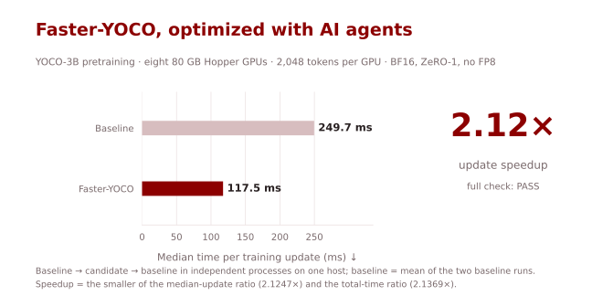
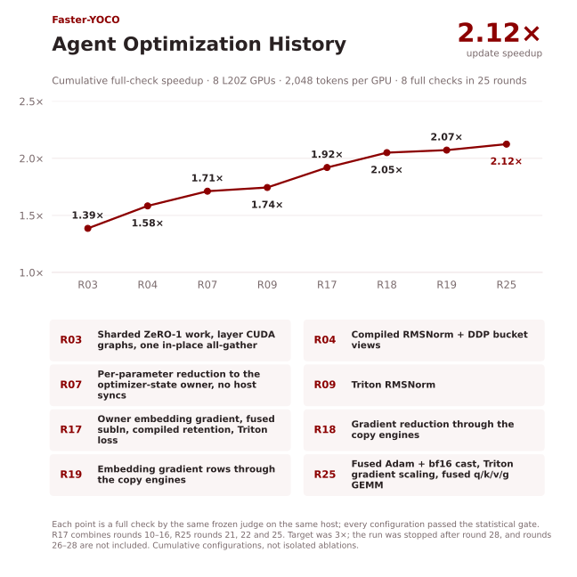
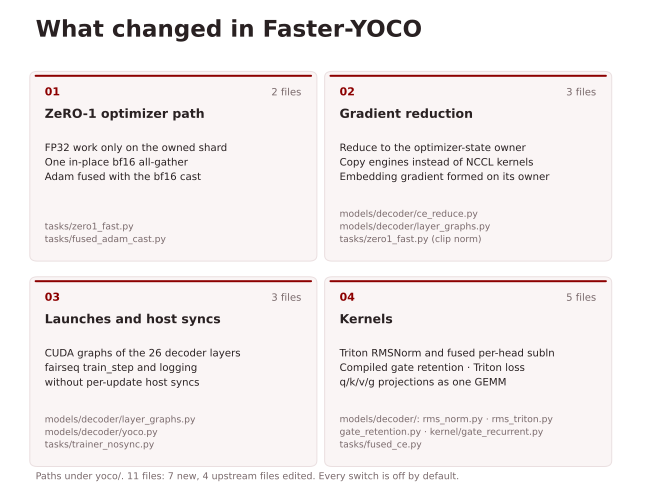
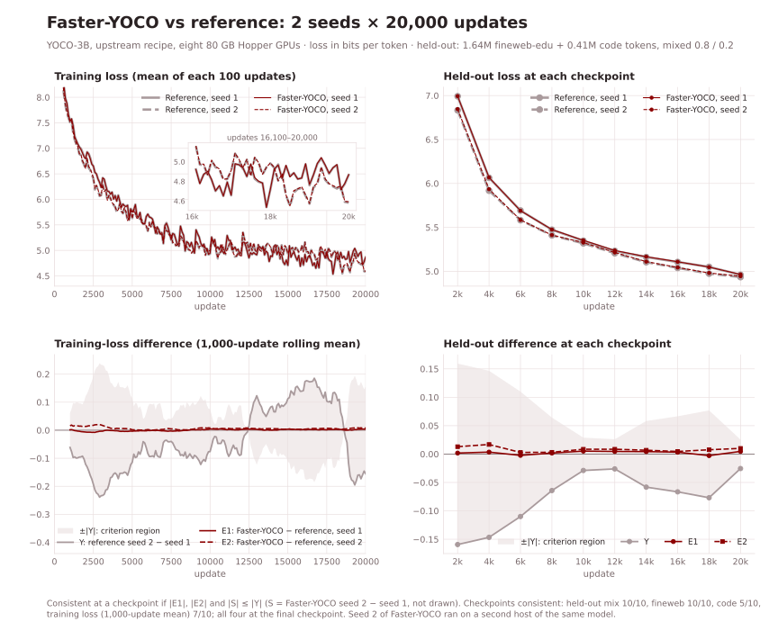
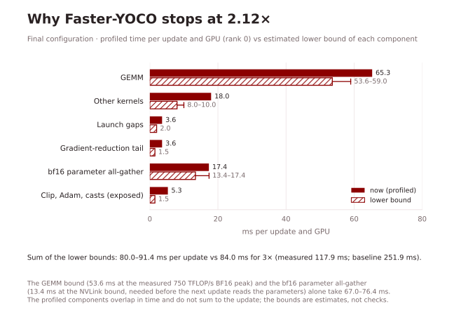
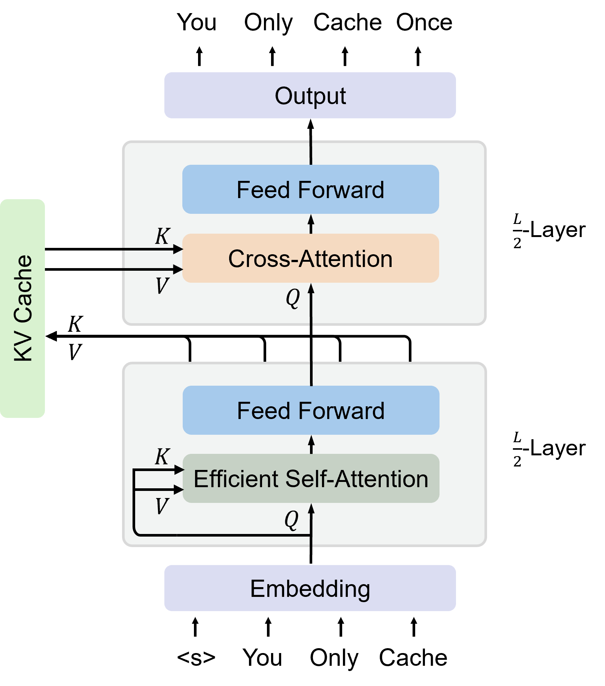
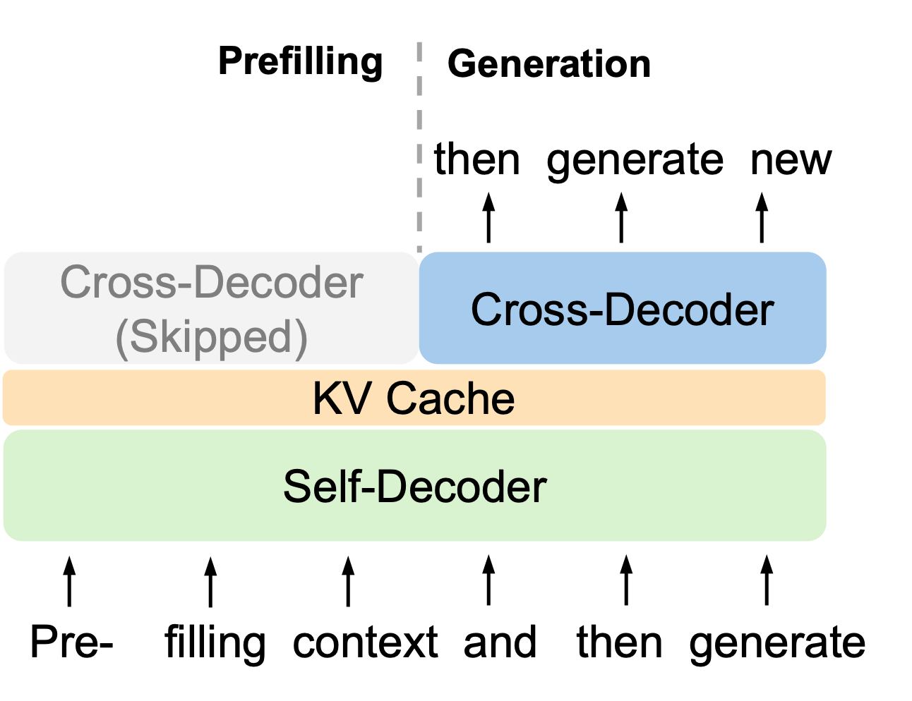
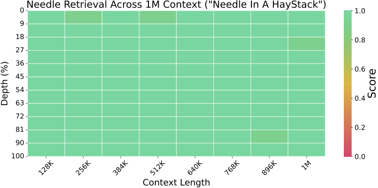

# Faster-YOCO

[English](README.md) | [简体中文](README.zh-CN.md)

**2.12× faster YOCO-3B pretraining updates on 8 NVIDIA H100 GPUs, optimized by AI agents.**



| Implementation | Time / update (ms) ↓ | Median update (ms) ↓ | Speedup ↑ |
|---|---:|---:|---:|
| Baseline | 251.9 | 249.7 | 1.00× |
| **Faster-YOCO** | **117.9** | **117.5** | **2.12×** |

Measured with a full check on **8 NVIDIA H100 GPUs (80 GB)**: the upstream `scripts/train.sh` recipe for YOCO-3B (`yoco_3b`, 3.45B parameters), one 2,048-token sequence per GPU (16,384 tokens per update), BF16 with FP32 master weights and FP32 Adam state, ZeRO stage-1 optimizer sharding (`--zero-sharding os`), **no FP8**. The timer runs the repository's real `train.py`, and the candidate passed the check's numerical gates. The speedup is the smaller of the median-update ratio and the total-time ratio (2.1369×): **2.1247×**.

In a 20,000-update training run on the same host, Faster-YOCO took **2,799 s** against **5,345 s** for the baseline: **1.91×** end to end, including start-up and model saves (0.1180 vs 0.2497 s per update). It uses more memory: 55.4 vs 48.3 GiB peak allocated per GPU in that run (**+7.1 GiB**).

## Quick Start

Prepare the [environment and the training data](docs/training.md). The optimizations are environment switches on the upstream trainer; the launcher sources them and runs the upstream YOCO-3B command on 8 GPUs:

```bash
export DATA_DIR=/path/to/Data        # json/train.json, json/<source>.json, shard/<source>/*.jsonl
export OUTPUT_DIR=/path/to/output
bash scripts/train_faster_yoco_3b.sh --max-update 20000
```

Equivalently, `source scripts/configs/faster.env` and run the upstream `torchrun ... train.py` command from `yoco/` with the [recorded deviations](docs/training.md#launch). Tested only with **PyTorch 2.3.1 + CUDA 12.1 (Triton 2.3.1), apex, flash-attn 2.6.3 and the fairseq fork pinned by upstream**, on 8 GPUs with `--zero-sharding os`. Every switch is off by default; with none set, the code takes the upstream path.

## Agent Optimization History

Each point is a full check on the same host, 8 NVIDIA H100 GPUs, 2,048 tokens per GPU.



## What changed

- **ZeRO-1 optimizer path:** upstream copies, scales and normalizes the full FP32 gradient on every rank and broadcasts the full FP32 master weights; here each rank does the FP32 work only for its own shard, and the updated BF16 parameters are exchanged with one in-place all-gather into the buffer the parameters live in. Adam writes the BF16 copy itself (Triton).
- **Gradient reduction:** instead of DDP's bucketed all-reduce, each gradient goes only to the rank that owns its optimizer state (ZeRO-2 style), pushed through the GPUs' copy engines so that no reduction kernels compete with the backward GEMMs; the owner sums the eight contributions in FP32 in rank order. The token-embedding gradient is formed on its owner from all ranks' token rows.
- **Launches and host syncs:** the 26 decoder layers run as CUDA graphs (forward and backward), and fairseq's `train_step` and end-of-update logging no longer wait for the GPU.
- **Kernels:** Triton RMSNorm (and the per-head norm fused with its transpose), Inductor-compiled elementwise work around the gated-retention recurrence, a Triton cross-entropy on the BF16 logits, and the q/k/v/g projections as one GEMM.



See the [switch table](docs/training.md#switches) and the [measured configuration](scripts/configs/faster.env). The changes alter floating-point rounding and reduction order; they are not lossless.

## Validation

**Numerical check.** The final configuration passed the [frozen judge](docs/judge.md): structure and exact items (recipe, data, RNG fingerprints, call counts, learning rate, Adam hyper-parameters, dtypes) with no failure; 5,123 of 38,464 recorded tensors were bitwise identical rather than all, so the statistical gate decided. It trains 200 updates from scratch with three paired seeds; the tolerance δ is twice the baseline's own seed-to-seed standard deviation, frozen from six baseline seeds.

| Loss window (updates) | Mean difference (nats) | Difference / baseline σ | Within δ = 2σ |
|---|---:|---:|:---:|
| 5–15 | +0.00003 | +0.03 | ✓ |
| 15–25 | −0.00000 | −0.00 | ✓ |
| 25–35 | −0.00004 | −0.08 | ✓ |
| 35–50 | +0.00001 | +0.03 | ✓ |
| 50–100 | −0.00095 | −0.22 | ✓ |
| 100–200 | −0.00713 | −0.75 | ✓ |

**Long training.** Faster-YOCO and the baseline were each trained for 20,000 updates (328M tokens) with two seeds, using the same recipe; checkpoints every 2,000 updates were scored on a held-out set (1.64M fineweb-edu and 0.41M code tokens from files not used for training, exact duplicates of training documents removed) with the baseline model code. No run had a non-finite loss or gradient norm.



The yardstick is the baseline's own seed-to-seed difference, Y = ref<sub>s2</sub> − ref<sub>s1</sub>. A checkpoint counts as consistent if |E1|, |E2| and |S| are all at most |Y|, where E1 = opt<sub>s1</sub> − ref<sub>s1</sub>, E2 = opt<sub>s2</sub> − ref<sub>s2</sub> and S = opt<sub>s2</sub> − opt<sub>s1</sub>.

| Update | Y | E1 | E2 | S | Consistent |
|---:|---:|---:|---:|---:|:---:|
| 2,000 | −0.1593 | +0.0018 | +0.0130 | −0.1481 | ✓ |
| 4,000 | −0.1466 | +0.0034 | +0.0169 | −0.1332 | ✓ |
| 6,000 | −0.1100 | −0.0023 | +0.0029 | −0.1048 | ✓ |
| 8,000 | −0.0642 | +0.0018 | +0.0031 | −0.0629 | ✓ |
| 10,000 | −0.0289 | +0.0052 | +0.0085 | −0.0256 | ✓ |
| 12,000 | −0.0261 | +0.0046 | +0.0085 | −0.0222 | ✓ |
| 14,000 | −0.0582 | +0.0043 | +0.0068 | −0.0558 | ✓ |
| 16,000 | −0.0665 | +0.0033 | +0.0046 | −0.0653 | ✓ |
| 18,000 | −0.0769 | −0.0027 | +0.0076 | −0.0666 | ✓ |
| 20,000 | −0.0255 | +0.0047 | +0.0100 | −0.0202 | ✓ |

Held-out loss of the 0.8 fineweb-edu / 0.2 code mix, bits per token.

| Metric | Consistent checkpoints | Final checkpoint |
|---|---:|:---:|
| Held-out mix | 10 / 10 | ✓ |
| Held-out fineweb-edu | 10 / 10 | ✓ |
| Held-out code (0.41M tokens) | 5 / 10 | ✓ |
| Training loss (1,000-update mean) | 7 / 10 | ✓ |

Of the eight misses, seven are in S alone; the eighth (code at 14,000) is in S and E1 (0.0179 vs |Y| = 0.0160). S − Y equals E2 − E1 by definition, and since both implementations see the same data order for a given seed, S follows Y closely: S exceeds |Y| whenever E2 − E1 has the sign of Y. Same-seed training curves correlate above 0.9999; their per-100-update differences average 0.004 (seed 1) and 0.007 (seed 2) bits in absolute value, against 0.13 bits between the baseline's two seeds.

**Caveat.** Faster-YOCO's held-out loss is slightly but consistently higher: E1 averages +0.0024 bits (8 of 10 checkpoints positive), E2 +0.0082 bits (10 of 10). That is at most 0.2% of the loss and smaller than the seed-to-seed difference at every checkpoint (by a factor of 2.6 or more; 2.6 is E2 at the final checkpoint), so it passes the criterion, but two seeds cannot tell whether a systematic offset of this size exists. Faster-YOCO's seed-2 run ran on a second host of the same model, so E2 also contains any difference between the hosts. No downstream evaluation was run.

See the [validation details](docs/training.md#validation) and [the scripts to rerun it](scripts/validate/).

## Why it stopped at 2.12×

3× means at most 84 ms per update. In the final configuration, GEMMs take about 65 ms of each update; at the measured BF16 peak their work alone needs 53.6 ms. After each update every GPU must also receive 6.0 GB of updated BF16 parameters before the next update reads them, which takes at least 13.4 ms over NVLink (17.4 ms with NCCL now). These two floors alone come to 67–76 ms, and the estimated lower bounds of all components sum to 80–91 ms, which would require every component at its hardware limit at once. FP8 was excluded. The run was stopped after round 28; the unfinished work of rounds 26–28 is not included.



See [why it stopped here](docs/training.md#why-it-stopped-here) and the directions that were tried and not adopted.

## More AI4AI-for-Anything projects

[Faster-JiT](https://github.com/AI4AI-for-Anything/Faster-JiT) · [Faster-RAE](https://github.com/AI4AI-for-Anything/Faster-RAE) · [Faster-LLaVA](https://github.com/AI4AI-for-Anything/Faster-LLaVA) · [Faster-DMD](https://github.com/AI4AI-for-Anything/Faster-DMD) · [Faster-SelfForcing](https://github.com/AI4AI-for-Anything/Faster-SelfForcing)

## Upstream YOCO documentation

Based on the `YOCO/` directory of [microsoft/unilm](https://github.com/microsoft/unilm/tree/master/YOCO) at `f4f7b27`, the code of [You Only Cache Once: Decoder-Decoder Architectures for Language Models](https://arxiv.org/abs/2405.05254). [MIT license](LICENSE) (the license of microsoft/unilm). The branch `upstream` holds the unmodified code. The original README is kept in [README.upstream.md](README.upstream.md) and below.

<details>
<summary>Original YOCO README: approach, results, setup, evaluation and pretraining</summary>

# You Only Cache Once: Decoder-Decoder Architectures for Large Language Models

## Approach
<div align="center">
  
</div>

<div align="center">
  
</div>

## Performance
### Harness Eval
Training with 1T Tokens: 
| **Model**                  | **Arc-c** | **Arc-e** | **BoolQ** | **Hellaswag**$^*$ | **OBQA** | **PIQA** | **Winogrande** | **SciQ** | **Avg** |  
|----------------------------|-----------|-----------|-----------|-------------------|----------|----------|----------------|----------|---------|  
| OpenLLaMA-3B-v2            | 0.339     | 0.676     | 0.657     | **0.700**         | 0.260    | 0.767    | 0.629          | 0.924    | 0.619   |  
| StableLM-base-alpha-3B-v2  | 0.324     | 0.673     | 0.646     | 0.686             | 0.264    | 0.760    | 0.621          | 0.921    | 0.612   |  
| StableLM-3B-4E1T        | ---       | 0.666     | ---       | ---               | ---      | **0.768**| 0.632          | 0.914    | ---     |  
| YOCO-3B                 | **0.379** | **0.731** | 0.645     | 0.689             | **0.298**| 0.763    | 0.639          | 0.924    | **0.634**| 

Training with 1.6T Tokens: 
| **Model**                  | **Arc-c** | **Arc-e** | **BoolQ** | **Hellaswag**$^*$ | **OBQA** | **PIQA** | **Winogrande** | **SciQ** | **Avg** |  
|----------------------------|-----------|-----------|-----------|-------------------|----------|----------|----------------|----------|---------|  
| StableLM-3B-4E1T      | ---       | 0.688     | ---       | ---               | ---      | 0.762    | 0.627          | 0.913    | ---     | 
| YOCO-3B               | 0.396     | 0.733     | **0.644** | 0.698             | 0.300    | 0.764    | 0.631          | 0.921    | 0.636   |  
| YOCO-3B-1M            | **0.413** | **0.747** | 0.638     | **0.705**         | 0.300    | **0.773**| **0.651**      | **0.932**| **0.645**| 
### Needle In A Haystack
<div align="center">
  
</div>

### Multi-Needle Eval
| **Model**               | **Size** | **N=1** | **N=2** | **N=4** | **N=8** |  
|-------------------------|----------|---------|---------|---------|---------|  
| GPT-4-128K              | --       | 1.00    | 1.00    | 0.98    | 1.00    |  
| MiniCPM-128K            | 2.4B     | 1.00    | 1.00    | 0.54    | 0.56    |  
| ChatGLM3-128K           | 6B       | 0.94    | 0.72    | 0.52    | 0.44    |  
| YaRN-Mistral-128K       | 7B       | 0.02    | 0.12    | 0.08    | 0.20    |  
| LWM-1M-text             | 7B       | 1.00    | 0.90    | 0.76    | 0.62    |  
| YOCO-3B-1M              | 3B       | 0.98    | 0.98    | 0.84    | 0.56    |  

## Setup
  
To install the required packages, use the following command:  
  
```bash  
pip install -r requirements.txt
```

Besides normal packages, [Apex](https://github.com/NVIDIA/apex) and [Flash-Attention](https://github.com/Dao-AILab/flash-attention) should be installed seperately following their offcial guidences.

## Harness Eval

To evaluate models in Harness-Eval, the script is as follows in ```scripts/eval_task.sh```:
```bash
cd fairseq/
TASK='harness_boolq'

torchrun --master-port=29505 --nproc_per_node=1 validate.py \
    --data-dir ../harness_data/ \
    --criterion harness_eval \
    --task harness_eval \
    --batch-size 4 \
    --eval-data ${TASK}  \
    --log-format simple  --log-interval 10 \
    --bf16 \
    --tokenizer-pad-to-multiple 8 \
    --arch yoco_3b_new --tiktoken-model cl100k_base --load-ckpt /path_to_ckpt/YOCO-3B-1M/checkpoint.pth --yoco-model /path_to_ckpt/YOCO-3B-1M  --tokens-per-sample 4096
```

## Needle In A Haystack Evaluation
Our model uses city-number pairs for long sequence evaluation. To get the results at a certain maximal length, the script is as follows in ```scripts/eval_needle.sh```:
```bash
cd fairseq/
torchrun --master-port=29504 --nproc_per_node=1 validate.py \
    --task pseudo \
    --criterion needle_haystack \
    --batch-size 1 \
    --max-epoch 1 \
    --no-save \
    --tiktoken-model cl100k_base \
    --bf16 \
    --arch yoco_3b_new --tiktoken-model cl100k_base --load-ckpt /path_to_ckpt/YOCO-3B-1M/checkpoint.pth --yoco-model /path_to_ckpt/YOCO-3B-1M --tokens-per-sample 1048576 --interval 1048576
```

To run Multi-Needle experiments, replace ```--criterion needle_haystack``` with ```--criterion multi_needle --needle-num {num}```.

## Pretraining From Scratch
To support distributed training, our implementation is based on infinibatch to read data iteratively. The overall data directory should be organized as follows:
```
Data/
├── json/
│   ├── train.json
│   └── CC.json
│   └── StarCoder.json
│   └── ...
├── shard/
│   ├── CC/
│   │   ├── 00000.jsonl
│   │   ├── 00001.jsonl
│   │   └── ...
│   └── StarCoder/
│       ├── 00000.jsonl
│       ├── 00001.jsonl
│       └── ...
```

We recommend that each sharded data files contains no more than 10K lines with one json dict per line, and jsonl file, such as ```Data/shard/CC/00000.jsonl```, should be in the format like this:
```json
{"text": "File 1 is here..."}
{"text": "File 2 is here..."}
...
```

Then, for each source, a JSON file preserves all the paths of the jsonl files. Take ```Data/json/CC.json``` for example:
```json
[
    "/path_to_data/Data/shard/CC/00000.jsonl",
    "/path_to_data/Data/shard/CC/00001.jsonl",
    ...
]
```

Finally, ```train.json``` records all sources' information and sampling ratio:
```json
[
    {
        "name": "CC",
        "weight": 0.5
    },
    {
        "name": "StarCoder",
        "weight": 0.2
    },
    ...
]
```

 ```scripts/train.sh```:
```bash
cd fairseq/
torchrun --nproc-per-node=1 train.py /path_to_data \
    --save-interval-updates 5000 \
    --no-epoch-checkpoints \
    --arch yoco_base \
    --criterion cross_entropy \
    --task gpt \
    --tokens-per-sample 2048 \
    --tokenizer-pad-to-multiple 8 \
    --pad-to-max-len \
    --optimizer adam --adam-betas "(0.9, 0.95)" \
    --adam-eps 1e-06 \
    --clip-norm 2.0 \
    --lr 0.00015 \
    --lr-scheduler polynomial_decay \
    --warmup-updates 50 \
    --weight-decay 0.05 \
    --batch-size 1  \
    --model-parallel-size 1 \
    --update-freq 1 \
    --batch-read-ahead 1000 \
    --total-num-update 300000 \
    --log-format simple      --log-interval 10    --disable-validation \
    --tiktoken-model cl100k_base \
    --save-interval-updates 5000 \
    --bf16 # bf16 is encouraged in pre-training
```

</details>
